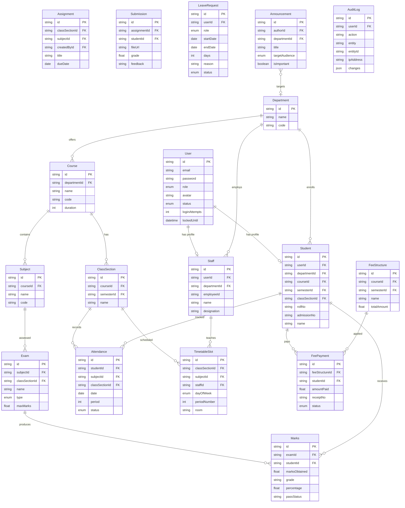

# 🎓 EduPulse – Student Management System

A **production-ready, full-stack Student Management System (SMS)** built as a monorepo with React (Vite) + Node.js + PostgreSQL.

---

## 🗂️ Monorepo Structure

```
student-management-system/
├── client/                   # React + Vite + Tailwind CSS frontend
│   ├── src/
│   │   ├── api/              # Axios client with JWT interceptors
│   │   ├── components/       # Shared UI components & layout
│   │   ├── context/          # Auth, Theme, Notification contexts
│   │   └── pages/            # All page modules (14 modules)
│   └── package.json
│
├── server/                   # Node.js + Express REST API
│   ├── prisma/
│   │   ├── schema.prisma     # Complete database schema (28+ models)
│   │   └── seed.js           # Full seed data script
│   ├── scripts/
│   │   └── start-db.js       # Embedded PostgreSQL launcher
│   ├── src/
│   │   ├── controllers/      # Route handler logic
│   │   ├── middlewares/      # Auth, RBAC, validation, upload
│   │   ├── routes/           # Express routers
│   │   ├── services/         # Business logic layer
│   │   ├── validators/       # Zod validation schemas
│   │   └── utils/            # Helpers: response, audit, jwt, email
│   └── package.json
│
└── README.md
```

---

## 🚀 Quick Start

### Prerequisites
- Node.js 18+ 
- npm 9+

### 1. Install Dependencies

```bash
# Install server dependencies
cd server && npm install

# Install client dependencies
cd ../client && npm install
```

### 2. Configure Environment

```bash
cd server
cp .env.example .env
# Edit .env if needed — defaults work out of the box
```

### 3. Start Database

```bash
cd server
node scripts/start-db.js
# PostgreSQL starts on localhost:5433
```

### 4. Run Migrations & Seed

```bash
cd server
npx prisma db push
node prisma/seed.js
```

### 5. Start Backend API

```bash
cd server
node src/server.js
# API: http://localhost:5000
# Swagger: http://localhost:5000/api/docs
```

### 6. Start Frontend

```bash
cd client
npm run dev
# App: http://localhost:5173
```

---

## 🔑 Default Login Credentials

| Role    | Email                    | Password     | Description                              |
|---------|--------------------------|--------------|------------------------------------------|
| Admin   | `admin@sms.com`          | `Admin@123`  | Full system access, all departments      |
| HOD     | `hod.cse@sms.com`        | `Hod@123`    | Head of CSE Department                   |
| HOD     | `hod.ece@sms.com`        | `Hod@123`    | Head of ECE Department                   |
| HOD     | `hod.mech@sms.com`       | `Hod@123`    | Head of MECH Department                  |
| Staff   | `staff.cse1@sms.com`     | `Staff@123`  | Faculty in CSE with mentorship students  |
| Student | `student.cse1@sms.com`   | `Student@123`| Student in CSE Sem 1, Section A          |

> **Tip:** The Login page has quick-fill buttons for all 4 roles for fast testing.

---

## 🏗️ Tech Stack

| Layer       | Technology                                                        |
|-------------|-------------------------------------------------------------------|
| Frontend    | React 18, Vite, Tailwind CSS, React Router v6                    |
| State       | React Query (TanStack Query v5), React Hook Form + Zod           |
| Charts      | Recharts (bar, pie, line, area)                                   |
| Backend     | Node.js + Express.js (MVC structure)                             |
| Database    | PostgreSQL (embedded) + Prisma ORM                               |
| Auth        | JWT access + refresh tokens, bcrypt, rate limiting               |
| File Upload | Multer (profile photos, assignments, materials)                  |
| Security    | Helmet, CORS, express-rate-limit, input sanitization             |
| API Docs    | Swagger / OpenAPI at `/api/docs`                                 |
| Testing     | Jest + Supertest (12 tests)                                      |

---

## 👥 RBAC Roles & Permissions

```
ADMIN  → Full system control (all departments, all users, settings)
  └── HOD    → Department-scoped control (own dept staff + students)
        └── STAFF  → Class/mentor-scoped (assigned students only)
              └── STUDENT → Self-only access (read-own data + limited actions)
```

Every API route enforces: **Authentication → Role Authorization → Data Scope Guard**

---

## 📦 Feature Modules

| Module             | Status | Routes                           |
|--------------------|--------|----------------------------------|
| Authentication     | ✅     | login, logout, forgot/reset pw   |
| Dashboards         | ✅     | role-specific stats + charts     |
| Academic Structure | ✅     | depts, years, courses, subjects  |
| User Management    | ✅     | HOD/Staff/Student CRUD + CSV     |
| Attendance         | ✅     | marking, calendar view, reports  |
| Marks & Exams      | ✅     | create exams, enter marks, GPA   |
| Timetable          | ✅     | weekly grid, clash detection     |
| Assignments        | ✅     | create, submit, grade, materials |
| Leave Management   | ✅     | apply, multi-level approval      |
| Fee Management     | ✅     | structures, payments, receipts   |
| Announcements      | ✅     | targeted by audience, urgent pin |
| Reports & Analytics| ✅     | attendance/marks/fee + CSV export|
| Audit Logs         | ✅     | every action logged w/ IP        |
| System Settings    | ✅     | institution profile, policies    |

---

## 🗄️ Database ER Diagram



---

## 🌐 API Endpoints Summary

| Base Route             | Description                              |
|------------------------|------------------------------------------|
| `POST /api/auth/login` | Login with email + password              |
| `GET  /api/dashboard`  | Role-scoped dashboard data               |
| `GET  /api/academic/*` | Departments, courses, subjects, classes  |
| `GET  /api/users/*`    | HOD/Staff/Student CRUD                   |
| `GET  /api/attendance` | List / mark / edit attendance            |
| `GET  /api/marks/*`    | Exams + marks entry + result cards       |
| `GET  /api/timetable`  | Weekly timetable (view / edit)           |
| `GET  /api/assignments`| Assignments + file submissions           |
| `GET  /api/leave`      | Leave apply + multi-level review         |
| `GET  /api/fees/*`     | Fee structures + payments + defaulters   |
| `GET  /api/announcements` | Campus-wide notice board              |
| `GET  /api/reports/*`  | Attendance / Marks / Fee CSV reports     |
| `GET  /api/system/*`   | Audit logs + settings                    |

📖 Full Swagger docs available at: **http://localhost:5000/api/docs**

---

## 🔒 Security Features

- JWT Access Tokens (15 min) + Refresh Tokens (7 days) with rotation
- bcrypt password hashing (12 rounds)
- Account lock after 5 failed login attempts (15 min cooldown)
- Helmet HTTP security headers
- CORS configuration
- Express rate limiting (100 req/15min global, 10 req/15min auth)
- SQL injection protection via Prisma parameterized queries
- XSS protection via input validation
- Soft deletes (data preserved, not permanently removed)
- All operations recorded in audit log with IP + timestamp

---

## 🧪 Running Tests

```bash
cd server
npm test
```

Tests cover:
- Auth (login, logout, refresh, RBAC)
- Department & academic CRUD
- Attendance marking with scope enforcement
- Leave management workflow
- Fee payment recording

---

## 📱 Responsive Design

- Mobile (320px+): collapsible sidebar drawer
- Tablet (768px+): condensed sidebar
- Desktop (1024px+): full expanded sidebar
- Dark mode: system-preference aware, togglable

---

## 🛠️ Scripts Reference

| Script                            | Action                        |
|-----------------------------------|-------------------------------|
| `node scripts/start-db.js`        | Start embedded PostgreSQL     |
| `npx prisma db push`              | Sync schema to database       |
| `node prisma/seed.js`             | Seed demo data (60 students)  |
| `node src/server.js`              | Start API server on :5000     |
| `npm run dev` (client)            | Start Vite dev on :5173       |
| `npm run build` (client)          | Production build              |
| `npm test` (server)               | Run Jest test suite           |
# Student-Management-System
